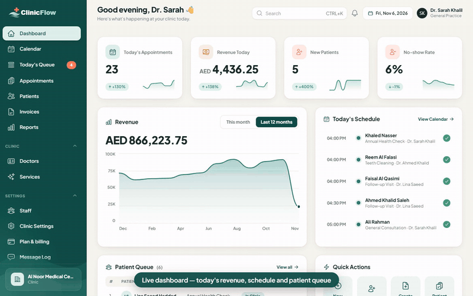
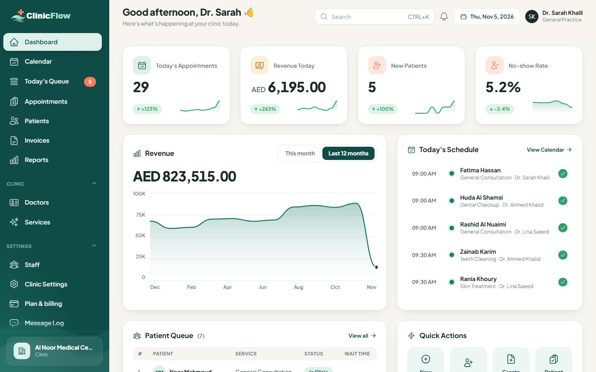
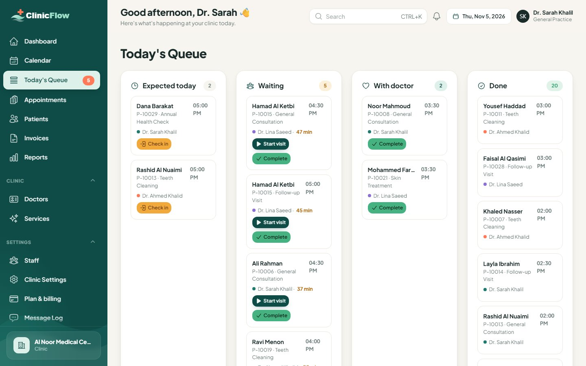
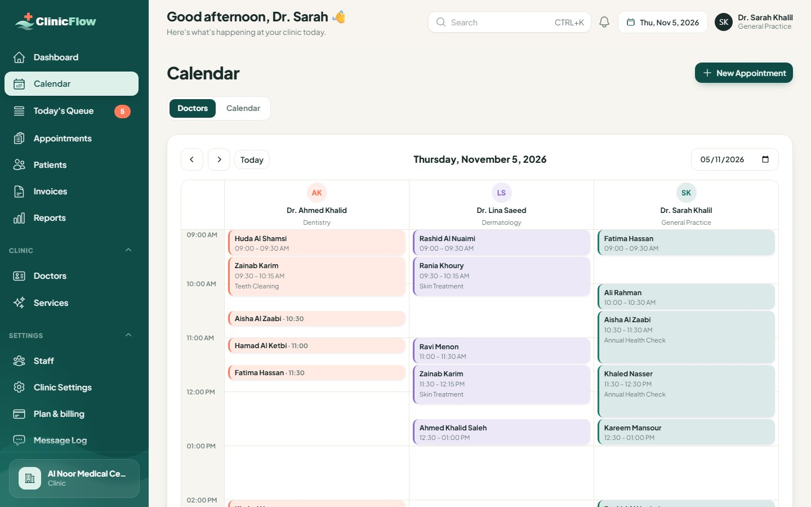
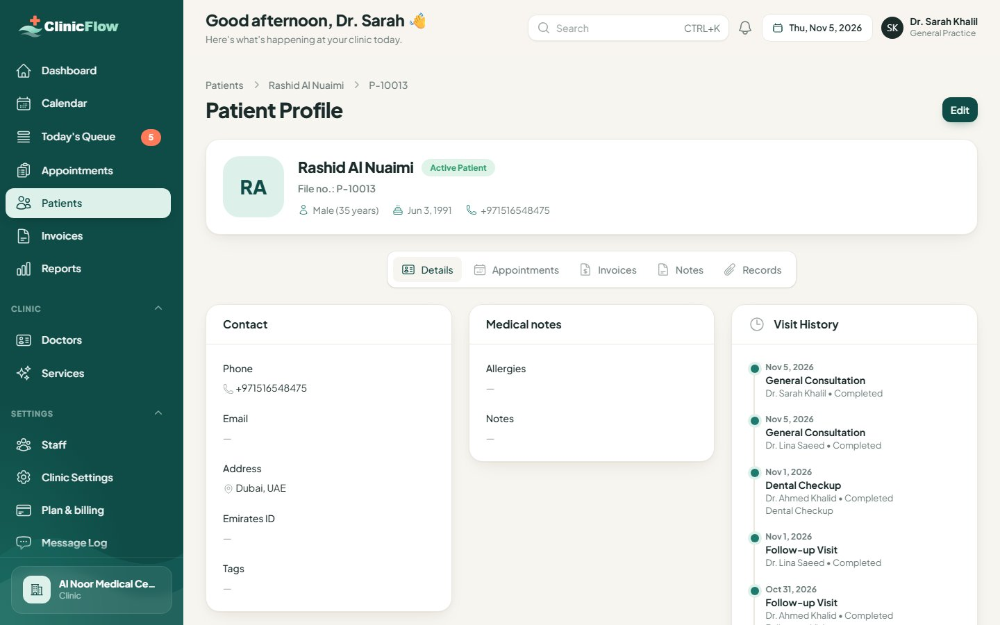
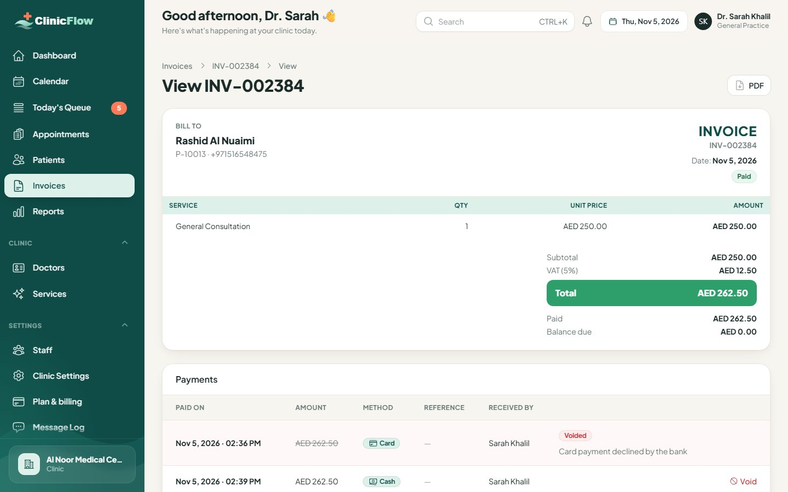
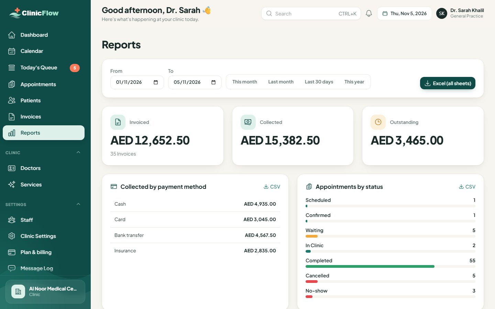
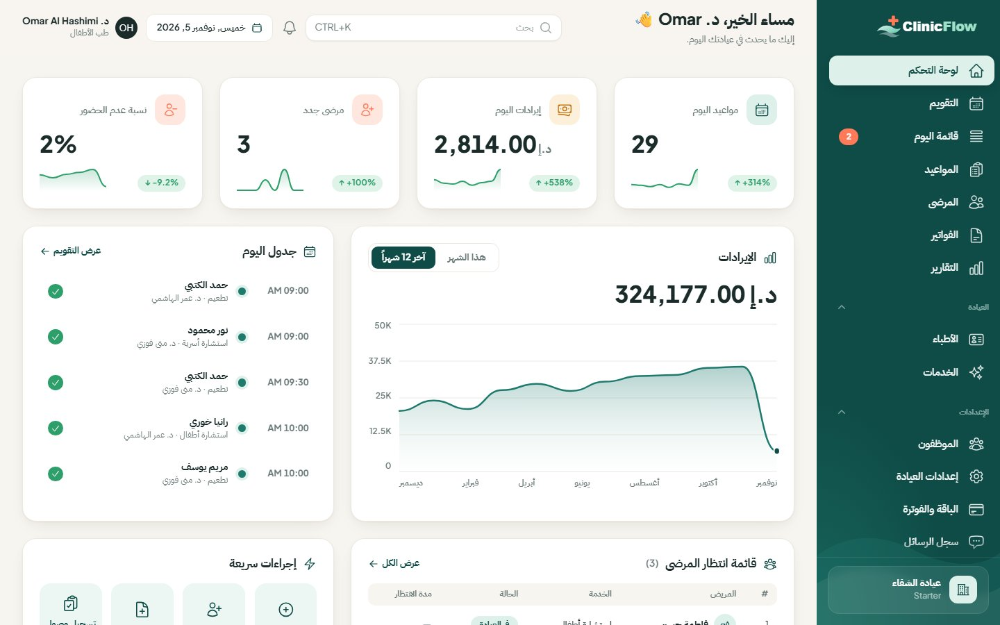
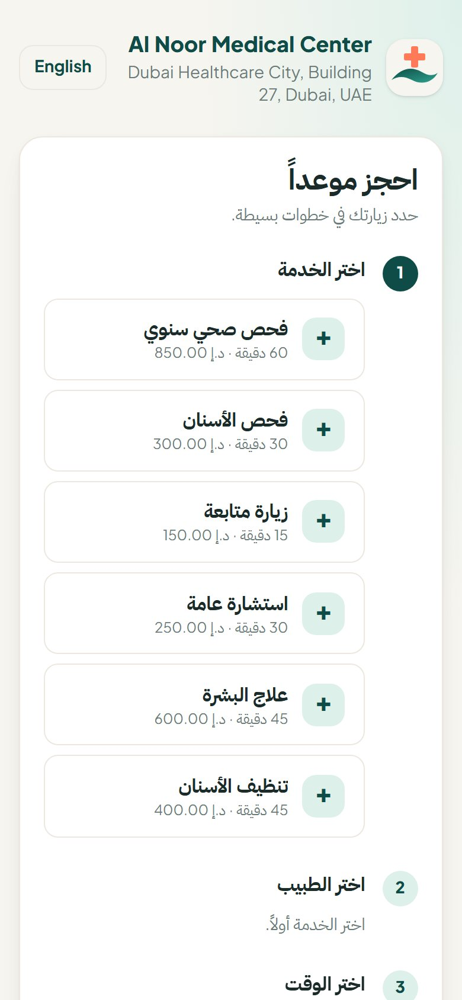

  

<h1 align="center">ClinicFlow</h1>

<b>Clinic management system for the UAE &amp; Gulf — appointments, patients, invoices, reminders and online booking, in English and Arabic.</b> 
Built with Laravel 13 + Filament 5. Run one clinic, or sell it as a SaaS.

<h2 align="center"><a href="https://flowapps.gumroad.com/l/clinicflow">🛒 Buy on Gumroad</a></h2>

  

<a href="images/clinicflow-demo.mp4"><b>▶️ Watch the full demo video</b></a>

> **Note:** Source code is available only with a purchased license.
> This repository contains screenshots and documentation only.

---

## What it does

ClinicFlow runs the daily work of a clinic: booking appointments, checking patients in, keeping
patient files, issuing VAT invoices and sending WhatsApp/SMS reminders. Patients book online from
their phone. One installation can host a single clinic or many clinics (SaaS), each with fully
separate data, staff, plan and booking page.

Made for the UAE and the Gulf: AED and Gulf currencies, VAT (5% by default), Emirates ID and UAE
phone validation, and full **Arabic (RTL)** and English everywhere — including PDF invoices and the
patient booking page.

## Features

**Appointments & calendar**
- Day board with a column per doctor (drag & drop), plus day / week / month calendar
- One availability engine: doctor schedules, clinic hours, holidays and days off — no double booking
- Today's queue: expected → waiting → with doctor → done, with check-in and wait times

**Patients**
- File numbers, fast search and duplicate warnings
- Profile with visit timeline, appointments, invoices, visit notes and private attachments
- UAE phone and Emirates ID validation

**Invoices & payments**
- VAT, discounts, partial payments; invoice in one click from a completed visit
- Branded PDF invoice in English or Arabic (RTL) with QR code
- Payments are never deleted: wrong payments are voided with a reason and an audit trail

**Dashboard & reports**
- Today's appointments, revenue, new patients and no-show rate with trends
- Revenue chart, today's schedule, patient queue, quick actions
- Reports by period (invoiced / collected / outstanding, payment methods, per doctor) with CSV and Excel export

**Reminders**
- WhatsApp Cloud API or Twilio SMS
- Confirmation, reminder and cancellation messages with editable Arabic and English templates

**Online booking**
- Mobile-first booking page per clinic: service → doctor → time → confirm
- Only truly free time slots; spam protection (rate limit, honeypot, optional captcha)

**Roles**
- Clinic admin, doctor (sees only their own appointments) and receptionist

**SaaS mode** (SaaS License)
- Super Admin panel for clinics, plans and global settings
- Plans with limits (doctors, appointments per month, online booking, reminders)
- Landing page with pricing, self-service signup with e-mail verification, onboarding wizard
- Free trials with reminder e-mails and plan requests

**Easy installation**
- Web installer: requirements check → database → admin account → optional demo data
- Works on shared hosting (cPanel / Plesk): no Redis, Node.js or Composer needed on the server

## Security

- Security-reviewed against the OWASP Top 10
- 224 automated tests (all passing)

## Screenshots

| | |
|---|---|
|  **Dashboard** |  **Today's queue** |
|  **Calendar** |  **Patient profile** |
|  **Invoice** |  **Reports** |
|  **Arabic dashboard (RTL)** |  **Online booking (mobile, Arabic)** |

## Requirements

- PHP **8.3+** (bcmath, ctype, curl, dom, fileinfo, gd, intl, mbstring, openssl, pdo_mysql, tokenizer, xml, zip)
- MySQL 8 or MariaDB 10.6+
- HTTPS (recommended)
- One cron job (every minute) for reminders

## Licenses

| | **Regular — $69** | **SaaS — $299** |
|---|---|---|
| Clinics | One clinic | Unlimited clinics |
| Charge other clinics (subscriptions) | ✗ | ✓ |
| Full source code and all features | ✓ | ✓ |

Both licenses prohibit reselling or redistributing the source code.

**[🛒 Buy on Gumroad](https://flowapps.gumroad.com/l/clinicflow)**

## Support

- E-mail: **flowapps.support1@gmail.com**
- Reply within 1–2 business days
- Free bug-fix updates for 6 months

---

## ClinicFlow بالعربي

**نظام إدارة عيادات للإمارات والخليج:** المواعيد، المرضى، الفواتير، تذكيرات واتساب والرسائل، والحجز الأونلاين — بالعربي والإنجليزي.
مبني على Laravel 13 و Filament 5. شغّله لعيادة واحدة أو بيعه كخدمة SaaS لعيادات متعددة.

**[🛒 اشترِ من Gumroad](https://flowapps.gumroad.com/l/clinicflow)** · **[▶️ شاهد فيديو العرض الكامل](images/clinicflow-demo.mp4)**

> **ملاحظة:** الكود المصدري متاح فقط مع شراء ترخيص. هذا المستودع يحتوي على صور وشرح فقط.

### المميزات
- **المواعيد:** لوحة يومية بعمود لكل طبيب مع السحب والإفلات، تقويم يومي/أسبوعي/شهري، ومنع الحجز المزدوج
- **طابور اليوم:** متوقع ← بالانتظار ← عند الطبيب ← انتهى، مع تسجيل الوصول ومدة الانتظار
- **المرضى:** رقم ملف، بحث سريع، تنبيه للتكرار، سجل الزيارات، ملاحظات ومرفقات خاصة، تحقق من رقم الهوية الإماراتية والهاتف
- **الفواتير:** ضريبة القيمة المضافة، خصومات، دفعات جزئية، فاتورة PDF بالعربي أو الإنجليزي مع رمز QR، والدفعات لا تُحذف بل تُلغى مع ذكر السبب
- **لوحة التحكم والتقارير:** الإيرادات، المرضى الجدد، نسبة عدم الحضور، وتصدير CSV و Excel
- **التذكيرات:** عبر WhatsApp Cloud API أو Twilio SMS بقوالب عربية وإنجليزية قابلة للتعديل
- **الحجز الأونلاين:** صفحة حجز للجوال لكل عيادة تعرض الأوقات المتاحة فعلاً فقط
- **الصلاحيات:** مدير العيادة، الطبيب (يرى مواعيده فقط)، موظف الاستقبال
- **وضع SaaS:** لوحة المدير العام، باقات بحدود، تسجيل ذاتي للعيادات، فترة تجربة مجانية
- **تثبيت سهل:** مثبّت من المتصفح، ويعمل على الاستضافة المشتركة

### الأمان
- تمت مراجعته أمنياً وفق OWASP Top 10
- 224 اختباراً آلياً (جميعها ناجحة)

### المتطلبات
PHP 8.3 أو أحدث، MySQL 8 أو MariaDB 10.6+، شهادة HTTPS (موصى بها)، ومهمة Cron واحدة.

### التراخيص

| | **العادي — 69$** | **SaaS — 299$** |
|---|---|---|
| عدد العيادات | عيادة واحدة | عيادات غير محدودة |
| تحصيل اشتراكات من عيادات أخرى | ✗ | ✓ |
| الكود الكامل وجميع المميزات | ✓ | ✓ |

كلا الترخيصين يمنع إعادة بيع الكود المصدري أو توزيعه.

### الدعم
- البريد: **flowapps.support1@gmail.com**
- الرد خلال 1–2 يوم عمل
- تحديثات مجانية لإصلاح الأخطاء لمدة 6 أشهر

---

© 2026 Flow Apps. All rights reserved.

